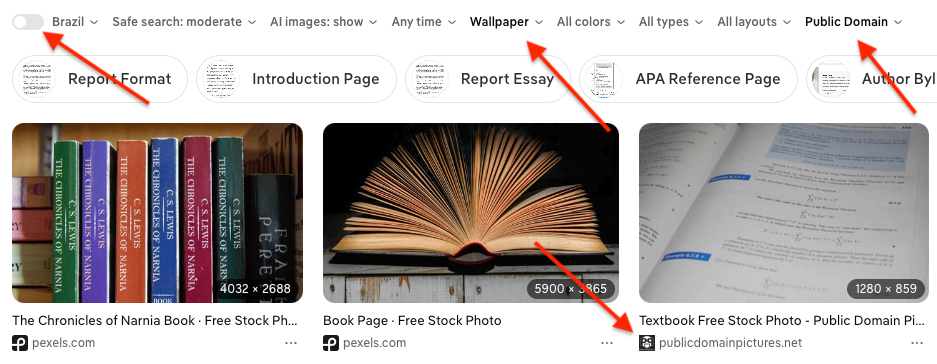

# sdet-automation-test
#### Version: 3

### What is Expected?

This is a code challenge to test your skills related to the development of automated tests. We use Selenium, Pytest and
Allure, but feel free to use any framework you are familiar with, as long as you develop it using Python.

The test consists in some steps to interact with a web page and assert some conditions, generating a report with the
test result after the execution.

## Test Scenario

For this test you should follow the steps:
1. Go to [DuckDuckGo](https://duckduckgo.com/).
2. Search for "**book {BOOK_NAME}**" (e.g: The miserable, Blindness...).
3. Select images.
4. Disable country location filter, if enabled, to allow find from any country
5. Choose **Wallpaper** size filter.
6. Choose Public Domain license filter.
7. Validate third image found is **publicdomainpictures.net** and the image is bigger than 1000x1000 pixels.
 


### Implementation Requirements
1. Use Page Object Model (POM) to implement the page interactions.
2. If you have experience with:
    1. use data [parametrization](https://docs.pytest.org/en/stable/example/parametrize.html), instead hard coded data.
    2. If possible, use [Fixtures](https://docs.pytest.org/en/stable/how-to/fixtures.html) (or something like) to go to 
   the page and perform the search (i.e. first two steps).

---

## How to run

```bash
python3 -m venv .venv
source .venv/bin/activate
pip install -r requirements.txt
pytest
allure serve allure-results   # HTML report (brew install allure)
```

`pytest` writes results to `allure-results/`.  
On failure, `tests/conftest.py` attaches a PNG screenshot of the browser to that Allure report.

POM: `pages/duckduckgo_page.py`  
Fixtures + failure screenshot: `tests/conftest.py`  
Parametrized books: `The miserable`, `Blindness`
